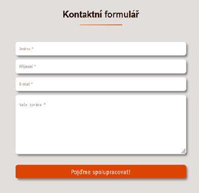

# Interactive Contact Form with JS Validation & PHP Mailer

A fully interactive and responsive contact form showcasing **client-side validation, smooth UX feedback, and server-side email sending via PHP Mailer**. This project emphasizes clean, maintainable code, interactivity, and professional integration.

## 🎯 Features & Benefits

- **Client-side validation**: real-time error messages for required fields and proper email format  
- **Dynamic feedback**: submit button shows a loading animation, success checkmark, or error message  
- **Server-side email sending**: securely handled via PHP Mailer with customizable SMTP settings  
- **Interactive UX**: errors disappear as the user types, form resets on successful submission  
- **Clean & extendable code**: easy to integrate into any website or adapt for other forms  
- **Professional workflow**: demonstrates thoughtful integration of frontend and backend code  
- **Enhances user experience**: smooth interactions and visual feedback make the form user-friendly  

## 🚀 How to Run / Usage

1. Clone or download the repository.  
2. Make sure you have a PHP-enabled server (XAMPP, MAMP, or similar).  
3. Open `index.html` via your server or in a browser for testing.  
4. Fill in the form and click **Submit**.  

> ⚠️ PHPMailer requires proper SMTP configuration in `PHPMailer/mailer.php` to send emails successfully.

## 📸 Screenshot

